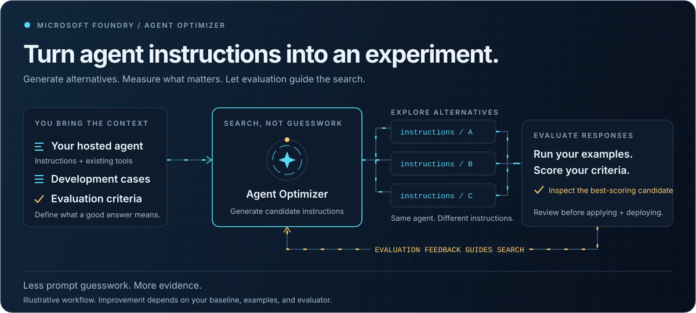

# Promotion Policy Optimizer



A public, guided demonstration of **Foundry hosted V1 -> Agent Optimizer -> hosted V2**.
Choose a fictional promotion request, compare decisions and calculations, and inspect actual
instructions, tool calls, response time, and API-reported token usage.

The interface follows Decision One: a static page, equal response cards, and expandable context.
Responses come from real Foundry calls. There is no replay mode or sign-in.

**Current status:** the anonymous website and hosted V1 work. V1 completed all ten held-out
requests, with all decisions correct and 53/54 business checks passing. A real optimization
completed on the eight development cases with a baseline evaluator score of 1.0. Foundry
stopped early because all evaluation samples already had perfect scores and returned only
the baseline.
Retesting the unchanged hosted V1 on 12 harder development cases also returned a baseline score
of 1.0 and the same perfect-score early stop, with no optimized instructions.
The public UI now compares the separately named weak experiment's pinned V1 with reviewed V2.
A real optimizer job improved exact development correctness from **5/12 (41.7%)** to
**8/12 (66.7%)**. Candidate 2 was then manually corrected only to avoid applying the Germany
cap adjustment twice, with source hashes and an exact edit record.
Fresh public-browser measurements of the deployed pair passed **5/12 -> 10/12** development
cases and **2/8 -> 5/8** reserved holdout cases. Every one of the forty HTTP requests completed.
The reviewed-V2 gain is distinct from the optimizer-only gain; neither version is flawless.

## Architecture

```text
Browser -> Static Web Apps Free + managed HTTP API -> Foundry hosted agents and optimizer
```

The managed API uses Python 3.11 and the existing Foundry SDK; the hosted agent uses Python 3.13.
Foundry runs optimization while the browser polls its job ID. There are no application queues,
background workers, database, separately deployed website containers, or dedicated App Service plan.
Browser session storage remembers the current job and selected V2.

Foundry project operations use Entra authentication rather than Decision One's model-inference key.
A dedicated application's credential stays in encrypted backend settings, never browser code,
source control, or frontend build variables. Its project-scoped permissions and credential expiry
must be maintained.

## Experiment

The fictional policy covers product/region discount caps, minimum gross margin, restricted products,
incomplete requests, and escalation precedence. Real deterministic functions perform policy lookup
and offer calculations.

- Eight development cases feed the optimizer; ten different held-out cases measure results.
- Only instructions change. The model, tools, policy, schema, and cases stay fixed.
- V1 has legitimate baseline instructions, not deliberately incorrect behavior.
- Optimizer evaluator scores and deterministic business checks are distinct measurements.
- Edited requests have no canned correctness score. Missing tokens remain unavailable.
- Failed requests are reported, not replaced with sample output or hidden from evaluation totals.
- No improvement or a regression is a valid outcome.

Review the candidate instructions and select **Use this candidate** to create a separate hosted
version. V1 remains pinned. Merely marking an optimizer candidate as promoted is not treated as a
hosted deployment.
An overall successful optimizer job is not sufficient: a non-baseline candidate must have
completed evaluation and contain instruction changes. Candidate failures remain visible.

### New challenge experiment inputs

`agent/evaluation/challenge-development.jsonl` contains 12 new development problems;
`challenge-holdout.jsonl` reserves eight separate cases. Neither replaces the original datasets
or the public demo. Each row includes a natural-language request, a specific grading rubric,
canonical authoritative inputs, and exact expected numeric output.

The problems distinguish absent costs from confirmed zero costs, gross margin from markup,
HALF_UP rounding before margin calculation, corrected versus stale prices, regional caps,
competing rejection/escalation rules, restricted full-price products, invalid prices, and
requester-supplied claims of tool execution. Judge the actual tool arguments as well as the
final decision: a correct `clarify` response must not conceal an invented zero-cost calculation.

`agent/evaluation/starter-prompts.json` supplies three deliberately weak synthetic alternatives:
an underspecified sales assistant, a tool-skipping speed-first assistant, and an approval-biased
assistant that suggests assumptions. These are explicitly flawed experiment seeds, not the
original deployed V1 or production recommendations. The model, business rules, tools and
schema remain fixed. In the isolated weak mode, the workflow belongs in tunable instructions
rather than an appended reference contract.

The current API still uses the original dataset. Run the separate challenge experiment against
the unchanged hosted V1 using the configured project endpoint and pinned baseline version:

```powershell
.venv\Scripts\python.exe scripts\run_challenge_optimization.py --wait-seconds 1800
```

The runner checks the existing model deployments and hosted baseline before submission. It sends
only the 12 development requests, their grading rubrics, and expected structured fields. It records
the operation ID, actual job ID, dataset hash, target version, models, and candidate results in
`.azure/challenge-optimization.json`. Rerunning resumes the recorded job; it rejects state for
different experiment inputs. A local wait timeout does not cancel the Foundry job. The runner never
applies or deploys a candidate.

The real challenge run, `opt_6eaf860d1d554d699b72869935092855`, completed successfully
with `builtin.task_adherence` baseline/best scores of **1.0/1.0**. The baseline was the only
completed candidate; the `candidate_1` placeholder failed without instructions or an evaluation
score. Foundry reported: "Optimizer returned only the baseline; no optimized candidates were
generated" and "Optimization stopped because all candidates already achieve perfect scores on
the evaluation samples."

This run used the original deployed V1, not a synthetic weak starter. The eight new holdouts
were not submitted or measured. A perfect development judge score is not an independent
deterministic audit of every output and tool argument; no quality, cost, latency, or held-out
improvement has been demonstrated. The local monitor briefly lost access when Azure CLI token
acquisition exceeded its default ten-second timeout. It resumed the same recorded job using
a 60-second CLI credential timeout; no duplicate job or agent version was created.

Only a separately named experiment may use a weak starter profile. Do not include holdout rows
in optimization or select a starter based on its holdout performance. No optimization benefit is
established until a generated candidate is measured against its own pinned starting version.

### Repeated weak-prompt experiments

The original runtime appends the complete policy and review workflow after the tunable prompt.
That can rescue an otherwise weak starter. The isolated local sweep explicitly disables that
append for synthetic profiles, so the workflow must be supplied in their tunable instructions.
The reference keeps the original prompt plus the fixed contract. Policy lookup data, calculator,
model, structured schema and expected business answers remain unchanged.

```powershell
.venv\Scripts\python.exe scripts\run_prompt_sweep.py --rounds 2 --workers 2
```

This runs the reference and all three weak profiles against both development versions: the
original eight cases and the 12 challenges. Two full rounds produce 160 independent trials
using real Foundry model calls and the agent's actual tool loop. These are **local agent-code
experiments, not newly deployed hosted versions or Agent Optimizer scores**. The public hosted
entry point always keeps the fixed-policy default; no browser option can disable it.

Results, full responses, tool traces, tokens, latency, source hashes and exact prompt/data
snapshots persist in `agent/.foundry/results/prompt-sweep-paced.json`. Rerunning resumes completed
trials without repeating them; changed experiment inputs require a separate output path.
Request failures remain in the denominator and are recorded explicitly.

The primary measure is the fraction of trials passing every deterministic check. Decision
accuracy is reported separately. The checks require exact numeric answers, a real matching
policy lookup, calculator execution where required, and authoritative calculator arguments.
An invented zero cost or stale cost fails even if the final decision happens to be correct.
No holdout rows or expected answers are sent to the agent. These development scores do not
establish how the optimizer's built-in judge will score a synthetic baseline.

The first 160-trial sweep encountered 44 rate limits, two timeouts, and four invalid JSON outputs. The
deployment permits 50 requests/minute and 50,000 tokens/minute; two concurrent tool loops can
exceed those limits. Do not interpret transport errors as evidence of a bad prompt.
The current runner paces model requests globally, with a four-second minimum and a conservative
40,000 tokens/minute estimate including the output budget. Recover only transport failures:

```powershell
.venv\Scripts\python.exe -m scripts.recover_prompt_sweep
```

Recovery writes `agent/.foundry/results/prompt-sweep-paced-recovered.json`, leaving the original
evidence unchanged. It verifies the original prompts, datasets, runtime, policy and scoring
source, keeps every initial error and retry, and never retries an incorrect completed business
answer. Transient failures receive at most three recovery attempts. Request failures that
remain still count against the overall trial result.

The measured two-round experiment is retained in
`agent/.foundry/results/prompt-sweep-recovered.json`, with its exact original code archived in
`agent/.foundry/results/prompt-sweep-sources/`. Only the 46 transport failures were retried;
incorrect completed answers and invalid JSON were not retried. All transport failures were
resolved; five invalid JSON outputs remain counted as failures.

| Prompt | Original development: 8 cases x 2 | Challenge development: 12 cases x 2 |
| --- | --- | --- |
| Reference with full policy | 14/16 (87.5%) | 19/24 (79.2%) |
| Underspecified | 10/16 (62.5%) | 10/24 (41.7%) |
| Speed-first | 8/16 (50.0%) | 4/24 (16.7%) |
| Approval-biased | 10/16 (62.5%) | 12/24 (50.0%) |

These are **all-check correctness rates**, including tool execution and source fidelity, not
Foundry judge scores. The underspecified prompt passed 5/12 challenge cases in each round,
versus 10/12 and 9/12 for the reference. It approved a request with a missing list price by
inventing 600 in one round and 400 in the other, accepted a 19.99% margin against a 20% floor
in both rounds, and rejected rather than escalated an over-cap, loss-making request.
This is a plausible weak starting configuration, not a deployed replacement for V1.

A fresh, fully paced confirmation ran the underspecified prompt once more on all 20 development
cases, with no request or JSON-validation failures. It again passed 5/8 original cases and
5/12 challenge cases; challenge decision accuracy was 6/12. The challenge all-check result is
therefore **5/12 in three separate rounds**, not a selected one-off bad answer. This confirmation
is saved in `agent/.foundry/results/prompt-sweep-confirmation.json`; the catalog records
`underspecified` as the selected experimental starter. These local measurements preceded the
separate hosted experiment below; they are not optimizer scores.

### Isolated hosted optimization

`promotion-policy-experiment` version **1** is deployed in the existing project. Its
`experiment.py` entry point uses the selected underspecified prompt from
`.experiment_configs/baseline/`, explicitly without the fixed-policy append. The original
`main.py` entry point and original `promotion-policy` version 1 remain unchanged. The website
now targets the experiment's pinned V1 and reviewed V2, as described below.
Both hosts retain the same model, real tools and structured output schema. Agent packages exclude
evaluation datasets and historical experiment outputs.

The earlier evaluator, `builtin.task_adherence`, does not accept `ground_truth` in its data
schema; adding detailed reference answers therefore did not make it an exact business checker.
The isolated experiment instead uses `builtin.python_grader` version 1 with the self-contained
`agent/evaluation/business_grader.py`. Its score is 1 only if every expected decision, numeric
field and tool-input check passes. Missing or malformed response fields fail; invalid reference
data raises an error. Instructions are the only optimizer mutation and search is capped at two
new candidates, with one concurrent agent evaluation.

Before optimization, Foundry graded all twelve preserved development responses and matched
their known outcomes exactly: **five correct, seven incorrect**. This is grader calibration,
not a new hosted-agent measurement or an optimization benefit. Foundry's documented Python
grader mapping uses `item.response` for supplied responses and `item.sample.output_text` for
generated responses, rather than the standard OpenAI `sample.output_text` argument. Initial
mapping failures are retained separately, not counted as poor agent behavior.

The first isolated optimizer job, `opt_5acfc6e639ac421d83a005f60a4b0e89`, failed before
producing a baseline score. The optimizer adapter serialized `image_tag` as null, rejected by
the underlying evaluator API. After explicit approval, a retry pins the documented Python
image `2025-05-08`; calibration with that exact configuration again matched all twelve outcomes.
The retry, `opt_d7ab515d2f484fb082b6bd5c5a922046`, **succeeded**:

| Configuration | Exact development cases passed | Rate |
| --- | --- | --- |
| Hosted weak baseline | 5/12 | 41.7% |
| Optimizer candidate 1 | 8/12 | 66.7% |
| Optimizer candidate 2 | 8/12 | 66.7% |

Foundry selected candidate 2 as best; both generated candidates have the same score. The gain
is **25 percentage points**, measured by the calibrated business grader, not task adherence.
The full result and unedited generated instructions are persisted in
`.azure/weak-optimization-pinned-image.json`.

Review found a concrete policy error in both candidates: they instruct the agent to subtract
five points from the DE cap returned by `lookup_promotion_policy`, although that tool already
returns the region-adjusted cap. Better aggregate scores therefore do not mean the prompt is
safe to promote unreviewed. The reviewed deployment below fixes that tool-semantics error and
preserves the unedited optimizer result separately. No cost or latency benefit is claimed.

With the project endpoint, isolated agent name and actual pinned version configured, resume
the recorded run without resubmitting:

```powershell
.venv\Scripts\python.exe -m scripts.run_weak_optimization status --wait-seconds 1800
```

The runner requires verified remote calibration of the exact grader, verifies the hosted
weak prompt/model/mode, hashes the inputs and persists the operation ID before submission.
It refuses uncertain submissions instead of blindly creating another job. Both holdout
sets remain excluded from optimization and selection. The reviewed deployment below has now
received one independent held-out measurement.
The read-only `status` command verifies the remote target binding but does not require unchanged
local grading source. New submissions still require exact source/configuration hashes and
matching calibration. The submitted grader source is archived in
`.azure/weak-grader-pinned-image.py`; its scoring logic is identical to the shared grader on
all twelve optimization cases. The shared scorer also preserves the original development
cases that omit unknown calculation expectations.

### Deployed comparison UI

Deploy your own instance using the setup instructions below. Both cards are ready when configured:
weak `promotion-policy-experiment` **version 1** versus reviewed **version 2**. Use **Run comparison**
for one request or **Measure all cases** for the twelve development and eight holdout requests.
The UI reports all-check case-pass rates separately by split, includes failed requests in their
denominators, and allows inspection of instructions, actual tool calls, tokens and response time.
Deployed-version provenance records the actual optimizer job/candidate IDs, its 41.7% -> 66.7%
result, both instruction hashes and the exact manual edit. New optimizer jobs are submitted and
polled through Foundry using the web application's identity.

`scripts/prepare_reviewed_demo.py` exports the actual winning candidate and replaces exactly
three DE-related passages: the double-subtraction instruction, its field-population rule and
its misleading example. `agent/evaluation/reviewed-candidate.json` records every before/after
edit and both instruction hashes. No holdout data was used for that repair.
`reviewed.py` loads `.reviewed_configs/baseline/` without appending the reference policy.
Deploying this entry point created immutable version 2; the original weak version 1 still runs
its original source and configuration.

One fresh end-to-end run through the public browser UI measured:

| Cases passing every business check | Weak V1 | Optimized + reviewed V2 |
| --- | --- | --- |
| Development (12) | 5/12 (41.7%) | 10/12 (83.3%) |
| Reserved holdout (8) | 2/8 (25.0%) | 5/8 (62.5%) |

Decision accuracy was 6/12 -> 12/12 on development and 3/8 -> 7/8 on holdout. These are one-round
live measurements, not guaranteed future outcomes. All forty HTTP requests completed with no
browser-script errors. Full responses, checks, canonical requests, versions and screenshots
are preserved in `agent/.foundry/results/public-reviewed-comparison.json` and adjacent PNGs.
The Germany development request now correctly reports the tool's 10% cap, not 5%.
Residual failures remain visible; no incorrect answer was retried or removed.

The public deployment pins reviewed V2 through backend settings instead of browser session
storage. New optimizer runs still use only development cases and the exact Python grader.
Unreviewed candidate application is blocked for this curated comparison, so a new generated
prompt cannot silently replace the reviewed V2. No authentication was added.
The developer-submitted source job is readable by its original caller, but returns not-found
under the website's separate identity. It is therefore referenced as recorded provenance,
not automatically polled or replayed as a website job. Jobs started from the UI are monitored
under the same identity that submitted them. Every comparison still invokes the hosted agents.

## Local development

Install only in the isolated virtual environment:

```powershell
uv sync --default-index https://pypi.org/simple
$env:FOUNDRY_PROJECT_ENDPOINT = 'https://<resource>.services.ai.azure.com/api/projects/<project>'
$env:FOUNDRY_BASELINE_VERSION = '<version>'
.venv\Scripts\python.exe -m uvicorn demo.http_api:app --port 8000
```

Local development uses existing Azure developer credentials. Cloud hosting uses the three dedicated
`DEMO_TENANT_ID`, `DEMO_CLIENT_ID`, and `DEMO_CLIENT_SECRET` settings.
The environment-specific development lockfile is excluded; `uv sync` resolves dependencies
from the public registry and creates a local lockfile.

```powershell
.venv\Scripts\python.exe -m pytest -q
.venv\Scripts\python.exe -m ruff check agent demo tests scripts api
node --check web\app.js
```

Tests use test doubles; deployed code has no mock mode.

## Deployment

`azure.yaml` provisions Foundry/model resources and packages `agent` for code deployment.
`web-infra/main.bicep` creates only a Free static web app. The selected region is East US 2.
Optimizer access must be verified against the actual dedicated project.

Run `scripts/stage_api.py` before website deployment to copy shared modules and baseline instructions
into `api`. Generated copies are ignored by Git; business logic has one source of truth.
Deploy `web` and `api` together. `web/staticwebapp.config.json` selects Python 3.11 and anonymous access.

The managed API uses an explicit `api/http_app/function.json` binding and ASGI middleware.
Keep `host.json`'s HTTP prefix set to `api`, as required by Static Web Apps.
The SWA CLI skips API builds: package Linux Python 3.11 dependencies before publishing from Windows,
not the development environment's Windows/Python 3.13 binaries:

```powershell
.venv\Scripts\python.exe scripts\stage_api.py
uv pip install --python .venv\Scripts\python.exe --target api\.python_packages\lib\site-packages --python-version 3.11 --python-platform x86_64-manylinux_2_28 --only-binary :all: --requirements api\requirements.txt
```

Install missing SWA tooling only inside `.venv\tools\swa`, then publish both folders using
`--api-language python --api-version 3.11 --env production`. Supply the deployment token through
`SWA_CLI_DEPLOYMENT_TOKEN`, never a committed file or command-line argument.

| Backend setting | Value |
| --- | --- |
| `FOUNDRY_PROJECT_ENDPOINT` | Dedicated Foundry project's endpoint |
| `FOUNDRY_AGENT_NAME` | `promotion-policy-experiment` |
| `FOUNDRY_BASELINE_VERSION` | `1` |
| `DEMO_PROFILE` | `challenge` |
| `DEMO_REVIEWED_VERSION` | `2` |
| `FOUNDRY_AGENT_MODEL` | `gpt-4.1-mini` |
| `FOUNDRY_EVAL_MODEL` | `gpt-4.1-mini` |
| `FOUNDRY_OPTIMIZATION_MODEL` | `gpt-5.4` |
| `DEMO_TENANT_ID`, `DEMO_CLIENT_ID`, `DEMO_CLIENT_SECRET` | Backend application credentials |
| `DEMO_ORIGIN` | Exact public website origin |

Grant the backend identity the necessary Foundry data-plane permissions at this project only.
The deployed backend has project-scoped Foundry User permissions plus Reader on the two exact
model deployment resources, not the whole account. Optimizer dependency validation needs that
metadata access: without it, an existing model can misleadingly be reported as "not found."
Set an appropriate credential expiry and rotate credentials in encrypted backend settings.

## Operational boundaries

The API exposes catalog, single-version invocation, optimizer submission/status, and candidate
application endpoints. V1/V2 inference calls are independent, so each card can complete separately.
Static Web Apps has a 45-second API request limit. Inference uses a 32-second upstream timeout and
no SDK retries. Cold starts and slow agents can still exceed the request budget; public end-to-end
verification is required. Optimizer submission never waits for the optimization run to finish.

The **per-instance** guard permits four active operations, 100 inference starts/hour, three
optimization submissions/day, and six candidate applications/day. Restarts reset these counters;
scaled instances have independent counters. This is not a global quota or guaranteed spend cap.
Anonymous visitors consume the owner's Foundry/model capacity.